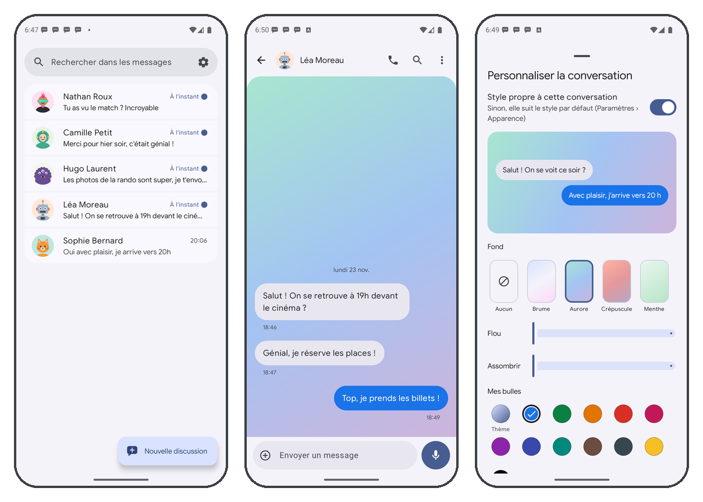
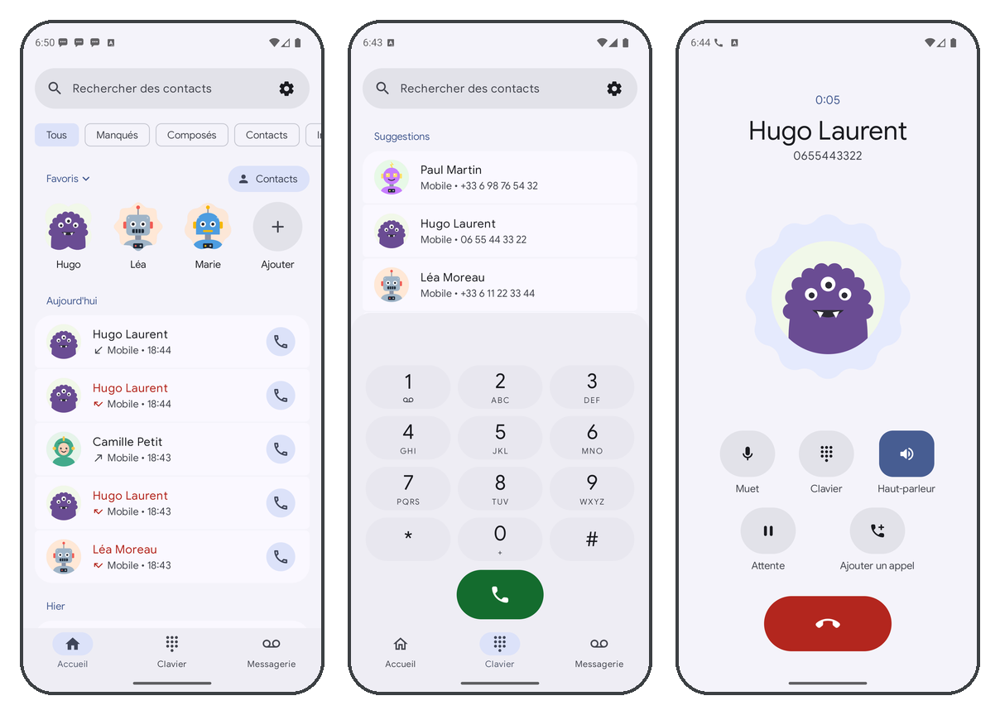
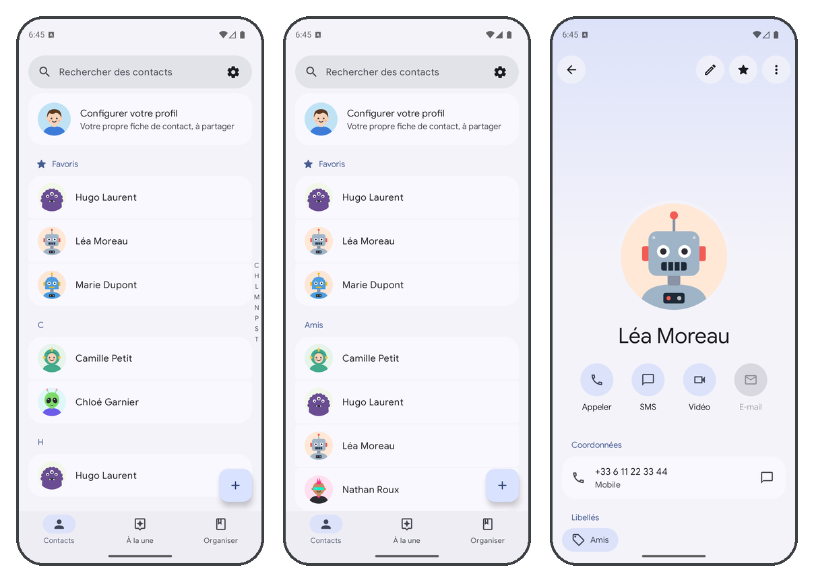
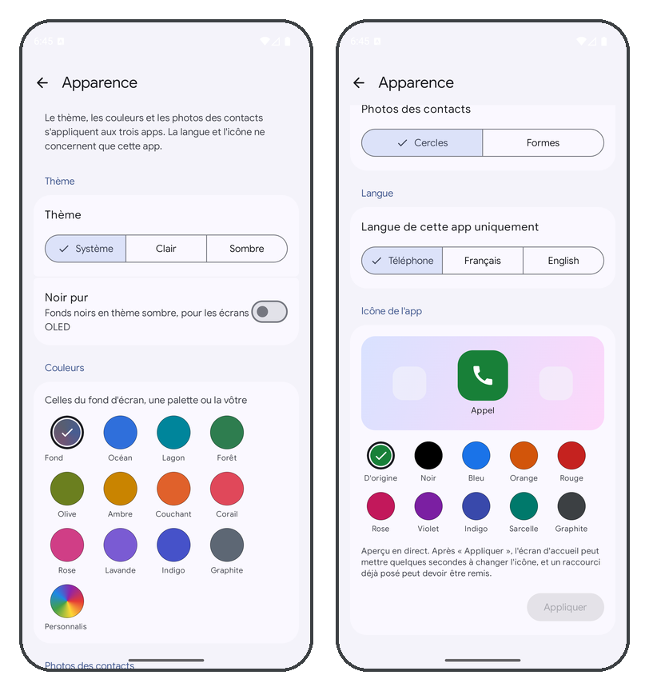

# SMS · Appel · Contacts

Trois applications Android qui fonctionnent comme une seule : même design (Material 3 Expressive,
couleurs du fond d'écran), mêmes avatars, même apparence réglée une fois pour les trois, et les
fonctions des applis Google et Samsung (blocage d'un numéro, réponse depuis la notification,
libellés de contacts, messagerie vocale visuelle…).

Elles s'appuient sur les trois applis open source de [jawsh207](https://github.com/jawsh207)
([Contacts](https://github.com/jawsh207/Contacts), [Dialtone](https://github.com/jawsh207/Dialtone),
[Twill](https://github.com/jawsh207/twill)), reprises ici avec leur historique.

| | Application | Icône | Android |
|---|---|---|---|
| 💬 | **SMS** | blanc sur bleu | 16 et plus |
| 📞 | **Appel** | blanc sur vert | 10 et plus |
| 👤 | **Contacts** | blanc sur orange foncé | 12 et plus |

## SMS



- SMS et MMS, conversations de groupe, réponse **depuis la notification**.
- SMS programmés, envoi différé avec annulation, aperçus de liens (désactivés par défaut).
- **Fond de conversation** au choix (fonds intégrés ou une photo à vous), avec flou et
  assombrissement, et **couleur des bulles** : par défaut ou conversation par conversation.
- Messages privés Nostr, avec ou sans SMS. Delta Chat n'est actif que si l'APK est compilé avec son
  moteur (`apps/messages/scripts/build-deltachat-core.sh`) ; ce n'est pas le cas des APK publiées.

## Appel



- Journal d'appels groupé, filtres (Tous, Manqués, Composés, Contacts, Inconnus), favoris.
- Clavier avec recherche T9, écran d'appel (muet, clavier, haut-parleur, attente, ajouter un appel),
  double appel et conférence.
- **Bloquer un numéro** (liste de blocage d'Android), le renvoyer directement vers la messagerie,
  refuser un appel avec un SMS.
- Messagerie vocale visuelle (protocoles OMTP, CVVM et VVM3) et transcription par l'app de
  reconnaissance vocale de votre choix.

## Contacts



- Liste classique (favoris puis A–Z) **ou par libellé**, avec l'ordre des libellés réglable.
- **Libellés** (groupes) : créer, ajouter des contacts, écrire à tout le monde d'un coup.
- Fusion des doublons, correction des fiches (numéros sans indicatif, fiches vides…), import et
  export vCard, anniversaires dans l'agenda, code QR de votre fiche.
- **Avatars illustrés** pour les contacts sans photo, les mêmes dans les trois apps.
- **Historique** sur la fiche d'un contact : ses appels et ses SMS dans une seule liste.
- **Synchronisation Nextcloud chiffrée** *(bêta)* entre plusieurs téléphones : voir plus bas.

## Synchronisation Nextcloud (bêta)

Contacts › Paramètres › **Synchronisation Nextcloud** : adresse du serveur, nom d'utilisateur, un
**mot de passe d'application** Nextcloud et une **phrase secrète**, la même sur tous vos téléphones.

- **Chiffrée de bout en bout** : AES-256-GCM, clé tirée de la phrase secrète (PBKDF2, 600 000
  itérations) et gardée dans l'Android Keystore. Le serveur ne voit jamais un nom ni un numéro.
- **Fusion intelligente** : un contact modifié sur deux téléphones est fusionné champ par champ ; si
  un téléphone n'a que le numéro et l'autre le nom, **le contact avec le nom est gardé** ; même
  numéro sous deux noms différents : les deux restent et apparaissent dans *Fusionner les doublons*.
- **Garde-fous** : une copie chiffrée des contacts est faite avant chaque modification, les
  suppressions en masse sont refusées, une modification l'emporte sur une suppression, et chaque
  téléphone n'écrit que son propre fichier sur le serveur (pas de conflit d'écriture).
- Synchronise les contacts du téléphone **et ceux de Google** (et des autres comptes modifiables,
  désactivable), toutes les 6 heures et une minute après un changement. Une même personne présente
  dans deux comptes n'est synchronisée qu'une fois. Les photos ne sont pas encore synchronisées.
- **Deuxième copie** : une sauvegarde complète et chiffrée des contacts est aussi gardée sur Nextcloud,
  chaque jour et après chaque modification (les 10 dernières).

Détails et règles : [docs/SYNC.md](docs/SYNC.md). Contacts demande pour cela la permission
Internet ; rien n'est envoyé tant que la synchronisation n'est pas configurée.

## Apparence (dans les trois apps)



Réglages › **Apparence** : thème clair, sombre ou système, couleurs du fond d'écran, d'une palette
ou personnalisées, noir pur pour les écrans OLED, avatars en cercles ou en formes, **langue
français ou anglais propre à chaque app**, et **couleur de l'icône** avec aperçu en direct (dix
couleurs, dont le noir pour un écran d'accueil sombre).

Le thème, les couleurs et les avatars se synchronisent entre les trois apps (elles doivent être
signées avec la même clé, ce qui est le cas des APK publiées). La langue et l'icône restent propres
à chaque app.

## Mettre à jour

Dans chaque app : Paramètres › **Mises à jour**. L'app compare sa version avec la dernière release GitHub (« Latest », ou aussi les bêtas si l'option est activée), télécharge son APK, vérifie son empreinte SHA-256, l'installe et se rouvre dans sa nouvelle version. La première fois, Android demande d'autoriser l'app à installer des applications. Les apps ne contactent GitHub que quand vous ouvrez cet écran.

## Installer

1. Télécharger les trois APK dans [Releases](../../releases) et les **extraire** si elles sont dans
   un zip (Android refuse de les ouvrir depuis l'intérieur d'une archive).
2. Si une ancienne version est installée, la désinstaller d'abord : elle était signée avec une autre
   clé. Contacts, appels et SMS ne sont pas supprimés, Android les garde.
3. Ouvrir chaque APK depuis l'appli Fichiers et autoriser l'installation d'applications inconnues.
4. Réglages › Applications › Applications par défaut : **Appel** pour le téléphone, **SMS** pour les
   messages.

### Android bloque les autorisations ?

Android protège les autorisations SMS et journal d'appels des applications installées hors d'un
magasin d'applications : le bouton Autoriser est grisé ou renvoie « Paramètre restreint ». Ce n'est
pas un problème de l'app, et rien dans l'app ne peut le contourner.

- Dans chaque app : Paramètres › **Autorisations bloquées ?** explique la marche à suivre et ouvre
  directement la bonne page.
- Ouvrir **Réglages › Applications › (l'app) › ⋮ en haut à droite › Autoriser les paramètres
  restreints** (le menu apparaît après un premier refus), puis accorder les autorisations.
- Ou installer les APK avec un installateur « par session » (Obtainium, F-Droid, Aurora Store) ou
  avec `adb install` : aucune restriction dans ce cas.
- Définir **Appel** et **SMS** comme applications par défaut leur accorde directement les
  autorisations d'appels et de SMS.

## Compiler

Android SDK 37 et JDK 17 ou 21 (avec JDK 21 seul, ajouter `-Pbundle.javaToolchain=21` à la commande de SMS).

```sh
./gradlew :contacts:assembleRelease :phone:assembleRelease     # Contacts et Appel
cd apps/messages && ./gradlew :app:assemblePerf                # SMS
```

Les trois apps sont signées avec la même clé : copier `signing.properties.example` en
`signing.properties` (ignoré par git) et y mettre votre keystore. Le préfixe des identifiants
(`app.bundle`) se change dans `gradle.properties`.

```
apps/contacts, apps/phone, apps/messages   les trois applications
core/design        thème, police, avatars (apps/…/avatars : illustrations et leur générateur)
core/appearance    apparence partagée, langue, icônes
core/telephony     comparaison des numéros, formats
core/sync          synchro Nextcloud : chiffrement, WebDAV, fusion (testé sur la JVM)
scripts/make_icons.py   génère les icônes et leurs variantes de couleur
```

## Licences

Apache-2.0 pour le code repris de Contacts, Dialtone et Twill (voir `LICENSE` et `NOTICE` dans
chaque dossier d'app) ; la police Google Sans Flex est sous licence SIL OFL 1.1.
